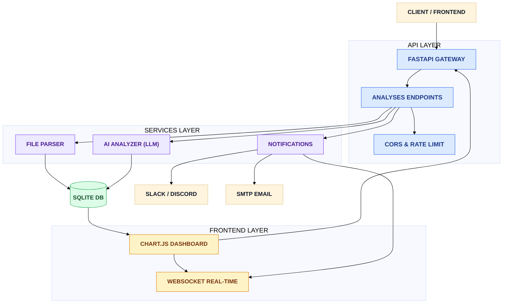
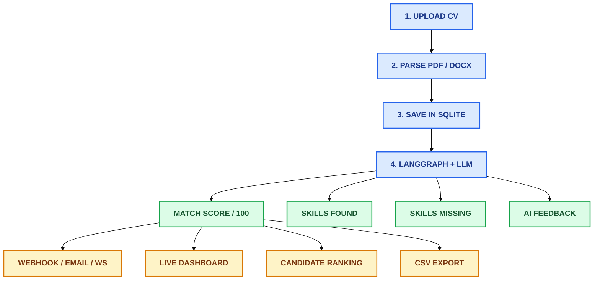
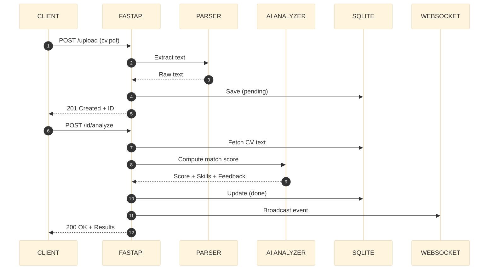
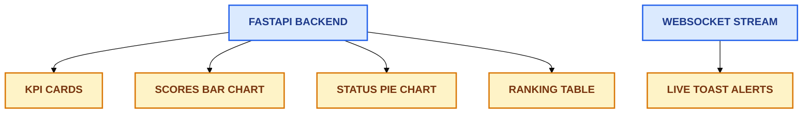
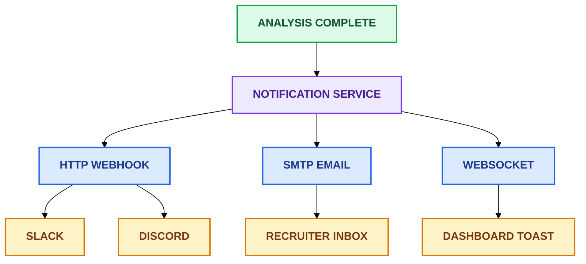
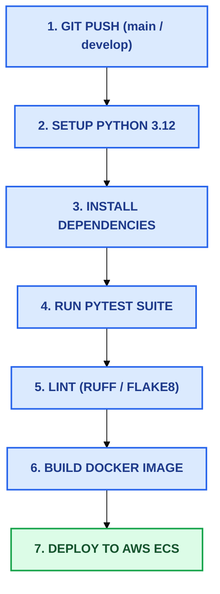

# 🤖 AI Recruiter Copilot


[](https://www.python.org/)
[](https://fastapi.tiangolo.com/)
[](https://langchain-ai.github.io/langgraph/)
[](https://www.docker.com/)
[](https://opensource.org/licenses/MIT)

> **AI-powered recruitment assistant** — Smart CV parsing, automated job matching with LLMs, real-time analytics dashboard, and multi-channel notifications.

**Core Stack:** `FastAPI` · `LangGraph` · `ChromaDB` · `LiteLLM` · `SQLAlchemy 2.0` · `Chart.js` · `WebSockets`

---

## 📑 Table of Contents

- [Architecture Overview](#-architecture-overview)
  - [System Architecture](#system-architecture)
  - [End-to-End Flow](#end-to-end-flow)
  - [Request Lifecycle](#request-lifecycle)
- [Tech Stack](#-tech-stack)
- [Prerequisites](#-prerequisites)
- [Quick Start](#-quick-start)
- [Configuration](#-configuration)
- [Running the Application](#-running-the-application)
- [API Endpoints](#-api-endpoints)
- [Query Parameters](#-query-parameters)
- [Request Examples](#-request-examples)
- [Dashboard](#-dashboard)
- [Notifications](#-notifications)
- [Testing & Load Testing](#-testing--load-testing)
- [CI/CD Pipeline](#-cicd-pipeline)
- [Project Structure](#-project-structure)
- [Roadmap](#-roadmap)
- [License](#-license)

---

## 🏗 Architecture Overview

### System Architecture



### End-to-End Flow



### Request Lifecycle



---

## 🛠 Tech Stack

| Category | Technology |
| :--- | :--- |
| **API Framework** | FastAPI (Python 3.12+) |
| **AI Orchestration** | LangGraph |
| **LLM Provider** | LiteLLM (OpenAI, Anthropic, Ollama…) |
| **Vector Store** | ChromaDB |
| **Database** | SQLite + SQLAlchemy 2.0 |
| **File Parsing** | PyPDF2, python-docx |
| **Validation** | Pydantic v2 / pydantic-settings |
| **Authentication** | JWT (PyJWT) |
| **Templating** | Jinja2 |
| **Dashboard** | Chart.js (CDN) |
| **Notifications** | Webhooks (HTTP), Email (SMTP), WebSockets |
| **Testing** | pytest, pytest-asyncio, httpx, Locust |
| **CI/CD** | GitHub Actions |
| **Containerization** | Docker / Docker Compose |
| **Deployment** | AWS ECS (Fargate) |

---

## 📋 Prerequisites

- **Python 3.12+** & `pip`
- **Docker & Docker Compose** *(optional, for containerized execution)*
- A valid **LLM API Key** (OpenAI, Anthropic, etc.)

---

## 🚀 Quick Start

```bash
# 1. Clone the repository
git clone https://github.com/<your-org>/ai-recruiter-copilot.git
cd ai-recruiter-copilot

# 2. Create and activate virtual environment
python -m venv .venv

# Windows PowerShell
.venv\Scripts\Activate.ps1

# Linux / macOS
source .venv/bin/activate

# 3. Install dependencies
pip install -r requirements.txt

# 4. Initialize configuration file
cp .env.example .env

# 5. Launch the API
uvicorn app.main:app --reload --host 0.0.0.0 --port 8000
```

### Access Points

| Interface | URL |
| :--- | :--- |
| **Swagger UI** | `http://localhost:8000/docs` |
| **ReDoc** | `http://localhost:8000/redoc` |
| **Visual Dashboard** | `http://localhost:8000/dashboard` |
| **Health Check** | `http://localhost:8000/health` |

---

## ⚙️ Configuration

Create a `.env` file at the project root:

```env
# ─── LLM ──────────────────────────────────────────────
LITELLM_API_KEY=sk-proj-xxxxxxxxxxxxxxxx
LITELLM_MODEL=gpt-4o

# ─── Vector Database ──────────────────────────────────
CHROMA_PERSIST_DIR=./data/chroma

# ─── JWT ──────────────────────────────────────────────
JWT_SECRET_KEY=change-me-to-a-long-random-secret-string
JWT_ALGORITHM=HS256
ACCESS_TOKEN_EXPIRE_MINUTES=30

# ─── CORS ─────────────────────────────────────────────
ALLOWED_ORIGINS=http://localhost:3000,http://localhost:8000

# ─── Notifications (optional) ─────────────────────────
WEBHOOK_URL=https://hooks.slack.com/services/xxx/yyy/zzz
SMTP_SERVER=smtp.gmail.com
SMTP_PORT=587
SMTP_USERNAME=your-email@gmail.com
SMTP_PASSWORD=app-password
NOTIFICATION_EMAIL=recruiter@company.com
```

> ⚠️ **Security Note:** Ensure `.env` is listed in your `.gitignore`. Never commit API keys or secrets to version control.

---

## ▶️ Running the Application

### Development (with hot-reload)

```bash
uvicorn app.main:app --reload --host 0.0.0.0 --port 8000
```

### Production

```bash
uvicorn app.main:app --host 0.0.0.0 --port 8000 --workers 4
```

### Docker Compose

```bash
docker-compose up --build
```

### Manual Docker Build

```bash
docker build -t ai-recruiter-copilot .
docker run -p 8000:8000 --env-file .env ai-recruiter-copilot
```

---

## 🔌 API Endpoints

### Analyses

| Method | Endpoint | Description |
| :--- | :--- | :--- |
| `POST` | `/api/v1/analyses/upload` | Upload a CV (`PDF`, `DOCX`, `TXT`) |
| `POST` | `/api/v1/analyses/{id}/analyze` | Analyze a CV against a job description |
| `GET` | `/api/v1/analyses` | List analyses (filtered, paginated, sorted) |
| `GET` | `/api/v1/analyses/ranking` | Retrieve candidate ranking by score |
| `GET` | `/api/v1/analyses/export/csv` | Export filtered results as CSV |
| `DELETE` | `/api/v1/analyses/{id}` | Delete an analysis by ID |

### Dashboard & WebSocket

| Method | Endpoint | Description |
| :--- | :--- | :--- |
| `GET` | `/dashboard` | Visual analytics dashboard with Chart.js |
| `WS` | `/ws` | Real-time WebSocket stream |

### System

| Method | Endpoint | Description |
| :--- | :--- | :--- |
| `GET` | `/health` | Service & database health check |

---

## 🔍 Query Parameters

### `GET /api/v1/analyses`

| Parameter | Type | Default | Description |
| :--- | :--- | :--- | :--- |
| `page` | `int` | `1` | Page number |
| `size` | `int` | `10` | Items per page |
| `min_score` | `float` | `—` | Minimum score filter (`0`–`100`) |
| `status` | `str` | `—` | Status filter: `pending`, `done`, `error` |
| `keyword` | `str` | `—` | Full-text search in `cv_filename`, `job_title`, `feedback` |
| `sort_by` | `str` | `created_at` | Sort field: `created_at`, `score`, `cv_filename` |
| `order` | `str` | `desc` | Sort direction: `asc` or `desc` |

---

## 💻 Request Examples

### 1. Upload a CV

```bash
curl -X POST "http://localhost:8000/api/v1/analyses/upload" \
  -F "file=@path/to/cv.pdf" \
  -F "job_title=Data Engineer"
```

```json
{
  "id": "21026043-de19-4edc-96ba-1f7436354c6e",
  "cv_filename": "cv.pdf",
  "job_title": "Data Engineer",
  "score": 0.0,
  "status": "pending",
  "result_json": null,
  "created_at": "2026-11-08T22:00:00"
}
```

### 2. Analyze a CV

```bash
curl -X POST "http://localhost:8000/api/v1/analyses/21026043-de19-4edc-96ba-1f7436354c6e/analyze" \
  -H "Content-Type: application/json" \
  -d '{
    "job_description": {
      "title": "Data Engineer",
      "required_skills": ["Python", "SQL", "Spark", "Airflow", "Docker", "AWS"],
      "experience_years": 3,
      "description": "We are looking for an experienced Data Engineer..."
    }
  }'
```

```json
{
  "id": "21026043-de19-4edc-96ba-1f7436354c6e",
  "score": 85.5,
  "status": "done",
  "feedback": "Strong candidate for the Data Engineer position...",
  "skills_found": ["Python", "SQL", "Docker", "AWS"],
  "skills_missing": ["Spark", "Airflow"]
}
```

### 3. List with Filters

```bash
# Pagination
curl "http://localhost:8000/api/v1/analyses?page=1&size=5"

# Minimum score filter
curl "http://localhost:8000/api/v1/analyses?min_score=70"

# Status filter
curl "http://localhost:8000/api/v1/analyses?status=done"

# Keyword search
curl "http://localhost:8000/api/v1/analyses?keyword=Python"

# Sort by score descending
curl "http://localhost:8000/api/v1/analyses?sort_by=score&order=desc"

# Combined query
curl "http://localhost:8000/api/v1/analyses?page=1&size=10&min_score=50&status=done&keyword=Data&sort_by=score&order=desc"
```

### 4. Candidate Ranking

```bash
curl "http://localhost:8000/api/v1/analyses/ranking"
```

```json
{
  "total": 6,
  "ranking": [
    {"rank": 1, "cv_filename": "marie_dubois.pdf", "job_title": "Data Engineer", "score": 100.0, "status": "done"},
    {"rank": 2, "cv_filename": "jean_martin.pdf",  "job_title": "Data Engineer", "score": 78.5, "status": "done"},
    {"rank": 3, "cv_filename": "sophie_bernard.pdf", "job_title": "Data Engineer", "score": 62.0, "status": "done"}
  ]
}
```

### 5. Export to CSV

```bash
curl -o analyses.csv "http://localhost:8000/api/v1/analyses/export/csv?status=done&min_score=70"
```

### 6. Delete an Analysis

```bash
curl -X DELETE "http://localhost:8000/api/v1/analyses/21026043-de19-4edc-96ba-1f7436354c6e"
```

```json
{
  "message": "Analysis deleted successfully",
  "id": "21026043-de19-4edc-96ba-1f7436354c6e"
}
```

### 7. Health Check

```bash
curl "http://localhost:8000/health"
```

```json
{
  "status": "healthy",
  "database": "ok",
  "timestamp": "2026-11-08T22:00:00Z"
}
```

### 8. WebSocket Stream

```bash
websocat ws://localhost:8000/ws
```

Payload broadcast upon each completed analysis:

```json
{
  "type": "analysis_complete",
  "id": "21026043-de19-4edc-96ba-1f7436354c6e",
  "cv_filename": "cv.pdf",
  "job_title": "Data Engineer",
  "score": 85.5,
  "status": "done",
  "timestamp": "2026-11-08T22:01:00Z"
}
```

---

## 📊 Dashboard

Access the interactive dashboard at `http://localhost:8000/dashboard`.



### Key Features

- **KPI Cards** — Total analyses, completed count, pending queue, and global average score.
- **Bar Chart** — Visual comparison of candidate match scores.
- **Pie Chart** — Real-time breakdown by analysis status (`pending` / `done` / `error`).
- **Ranking Table** — Sorted leaderboard featuring dynamic color-coded progress bars.
- **Live Toast Alerts** — Instant UI notifications triggered via WebSocket when an analysis completes.

---

## 🔔 Notifications

### Notification Architecture



### Integration Setup

- **Slack:** Visit [api.slack.com/apps](https://api.slack.com/apps) → Create a new app → Enable **Incoming Webhooks** → Copy the Webhook URL into `.env` (`WEBHOOK_URL=...`).
- **Discord:** Server Settings → **Integrations** → **Webhooks** → **New Webhook** → Copy the Webhook URL into `.env` (`WEBHOOK_URL=...`).

### Webhook Payload Format

```json
{
  "event": "analysis_complete",
  "candidate": "cv.pdf",
  "position": "Data Engineer",
  "score": 85.5,
  "status": "done",
  "feedback": "Strong candidate for the Data Engineer position..."
}
```

---

## 🧪 Testing & Load Testing

```bash
# Run full test suite
pytest -v

# Run with coverage report
pytest --cov=app -v

# Generate interactive HTML coverage report
pytest --cov=app --cov-report=html -v
open htmlcov/index.html
```

### Test Suite Structure

```text
tests/
├── conftest.py                      # Pytest fixtures and test DB setup
├── test_analyze.py                  # Core analysis pipeline tests
├── test_analyze_v2_fix.py           # Regression & v2 pipeline tests
├── test_monitoring.py               # Health check & monitoring tests
├── test_schemas_cv.py               # CV Pydantic schema validation tests
├── test_schemas_job_description.py  # Job description schema tests
└── locustfile.py                    # Locust performance/load testing suite
```

### Load Testing with Locust

```bash
pip install locust
locust -f tests/locustfile.py --host=http://localhost:8000
```

Then open `http://localhost:8089` (or your configured Locust port) in your browser to start simulating traffic.

---

## 🔄 CI/CD Pipeline



The automated workflow `.github/workflows/ci.yml` triggers on every push or pull request to `develop` and `main`:

1. **Setup Environment** — Provisions Python 3.12 with pip caching.
2. **Install Dependencies** — Installs `requirements.txt` and `requirements-dev.txt`.
3. **Automated Tests** — Executes unit and integration test suites via `pytest -v`.
4. **Code Quality** — Runs static analysis and formatting checks (`flake8` / `ruff`).
5. **Container Verification** — Builds the production Docker image.
6. **Continuous Deployment** — Pushes image and updates AWS ECS Fargate task *(optional)*.

---

## 📂 Project Structure

```text
ai-recruiter-copilot/
├── app/
│   ├── main.py                          # FastAPI application entry point
│   ├── api/v1/endpoints/
│   │   ├── analyses.py                  # CRUD, AI analysis, ranking & CSV export
│   │   └── health.py                    # Health check endpoint
│   ├── core/
│   │   ├── config.py                    # Environment settings (pydantic-settings)
│   │   └── database.py                  # SQLAlchemy engine & session management
│   ├── db/
│   │   └── models.py                    # SQLAlchemy ORM models (Analysis)
│   ├── schemas/
│   │   ├── cv.py                        # Pydantic schemas for CV payloads
│   │   └── job_description.py           # Pydantic schemas for Job Descriptions
│   ├── services/
│   │   ├── file_parser.py               # Document extraction (PDF / DOCX / TXT)
│   │   ├── analyzer.py                  # LangGraph workflow & LiteLLM scoring
│   │   └── notifications.py             # Multi-channel dispatcher (Webhook, SMTP, WS)
│   └── templates/
│       └── dashboard.html               # Jinja2 + Chart.js real-time dashboard
├── tests/
│   ├── conftest.py
│   ├── test_analyze.py
│   ├── test_analyze_v2_fix.py
│   ├── test_monitoring.py
│   ├── test_schemas_cv.py
│   ├── test_schemas_job_description.py
│   └── locustfile.py
├── deploy/
│   └── ecs-task-definition.json         # AWS ECS Fargate deployment config
├── .github/workflows/
│   └── ci.yml                           # GitHub Actions CI/CD pipeline
├── requirements.txt                     # Production dependencies
├── requirements-dev.txt                 # Development & testing dependencies
├── .env.example                         # Environment template
├── .gitignore
├── Dockerfile
├── docker-compose.yml
└── README.md
```

---

## 🗺 Roadmap

- [x] **Sprint 1** — Project scaffolding, Pydantic v2 schemas, GitHub Actions CI
- [x] **Sprint 2** — Core analysis pipeline (file upload, text extraction, LLM scoring)
- [x] **Sprint 3** — Complete REST API (CRUD, filtering, pagination, sorting, ranking, CSV export)
- [x] **Sprint 4** — Interactive visual dashboard (Chart.js, KPI cards, live WebSocket updates)
- [x] **Sprint 5** — Multi-channel notifications (Slack/Discord webhooks, SMTP email, UI toasts)
- [ ] **Sprint 6** — Advanced observability, structured logging, Prometheus & Grafana metrics
- [ ] **Sprint 7** — Role-based JWT authentication across all protected endpoints
- [ ] **Sprint 8** — Multi-tenancy, distributed rate limiting, and horizontal scaling

---

## 📄 License

Distributed under the **MIT License**. Free to use, modify, and distribute.
